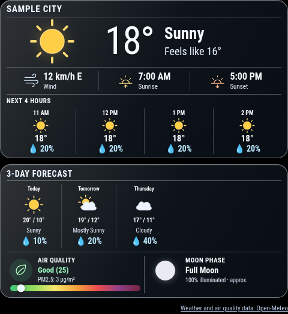

# MMM-WeatherCards

Configurable forecast, hourly weather, air quality and approximate lunar cards.

Version 0.1.0. MIT-licensed standalone MagicMirror module.



## Installation

From your MagicMirror installation directory:

```sh
cd modules
git clone https://github.com/QuietNodeLab/MMM-WeatherCards.git
```

Alternatively, download the repository ZIP and extract it as the folder below.

Copy this folder into `MagicMirror/modules/MMM-WeatherCards`. No extra npm
runtime packages or shared dashboard stylesheet are required. Use MagicMirror
2.38.0 with Node 24 as the tested baseline; other versions still need
verification.

Add a module entry to your local config:

```js
{
  module: "MMM-WeatherCards",
  position: "top_left",
  config: {
    "location": "Sample City",
    "latitude": 40.7128,
    "longitude": -74.006,
    "timezone": "America/New_York",
    "units": "metric",
    "hourlyCount": 4,
    "forecastDays": 3
  }
}
```

## Behavior and configuration

Configure your own latitude, longitude and display label locally. Example
coordinates identify a public city, not a private location. The frontend
contacts Open-Meteo forecast and air-quality endpoints directly. No NodeHelper,
companion module or API key is required.

Options: `location` (Sample City), `latitude` (40.7128), `longitude` (-74.0060),
`timezone` (America/New_York or a supported Open-Meteo zone), `units` (imperial
or metric), `locale` (en-US, for weekday formatting), `updateInterval` (900000
ms), `hourlyCount` (6, bounded 1–24), `forecastDays` (5, bounded 1–7). Metric
uses Celsius and km/h; imperial uses Fahrenheit and mph. AQI always uses the US
AQI scale. Descriptions remain English.

Count options are honored by requests and grids; excess columns can scroll
horizontally. Air-quality failures do not discard a successful weather forecast.
Existing data stays visible after later request failures. Lunar phase is an
approximation rather than an astronomical ephemeris. The screenshot uses
synthetic API responses. See ATTRIBUTION.md before commercial use of service
endpoints.

## Development

`npm ci --ignore-scripts` and `npm test` run offline with Node 24. External APIs
must be mocked. JSON date modules use calendar dates; the configured zone
selects "today". Private configuration and cache data are ignored. All example
people, locations and events are synthetic or public examples. Screenshots use
only mock data.

Styles are scoped to the module. Change its own card CSS in your local
custom.css if desired; do not copy a full dashboard theme. Keep filenames as
filenames rather than absolute deployment paths. JSON helpers search config
first, then the module. Timers stop when the module is suspended and restart
when it resumes.

See [VALIDATION.md](VALIDATION.md) for tests actually performed and their
limits.

## License and attribution

The custom package code is MIT-licensed under module contributors; see
[LICENSE](LICENSE). No source-project Git history, private configuration,
optional device services or upstream module implementation is bundled.
MagicMirror is a separate dependency. See [ATTRIBUTION.md](ATTRIBUTION.md) for
artwork and external data notes.
